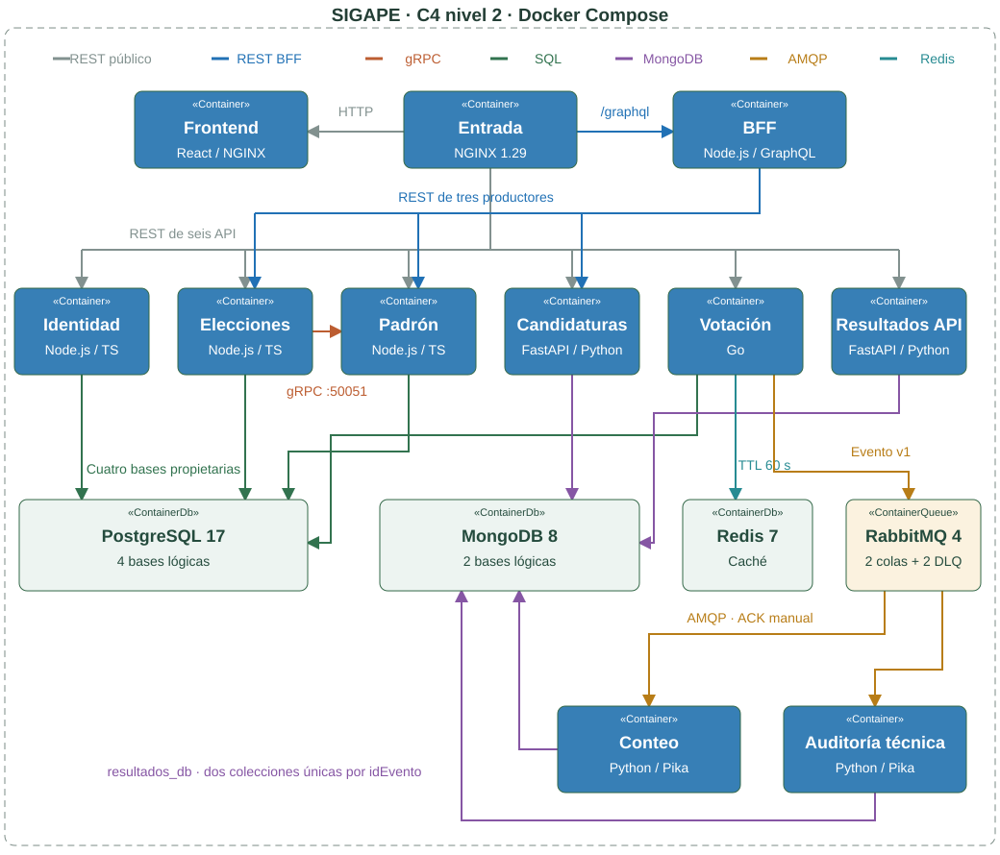

<style>
@page { size: A4; margin: 14mm 14mm 15mm; }
@media print {
  body { font: 9.5pt/1.28 Arial, sans-serif; color: #18312c; }
  h1 { font-size: 18pt; margin: 0 0 9pt; } h2 { font-size: 13pt; margin: 9pt 0 7pt; }
  h3 { font-size: 10.5pt; margin: 10pt 0 5pt; } h1,h2,h3 { break-after: avoid; }
  p { margin: 5pt 0; } ul,ol { margin: 5pt 0; padding-left: 17pt; }
  table { width: 100%; border-collapse: collapse; font-size: 8.1pt; margin: 7pt 0; }
  th,td { border: 1px solid #cbd7d2; padding: 4pt; vertical-align: top; } th { background: #edf3ef; }
  tr { break-inside: avoid; } code { font-size: 8pt; overflow-wrap: anywhere; }
  pre { white-space: pre-wrap; font-size: 8pt; line-height: 1.25; border: 1px solid #dce4df; padding: 7pt; }
  a { color: #245c4a; overflow-wrap: anywhere; } img { max-width: 100%; max-height: 235mm; object-fit: contain; }
  .salto-pagina { break-before: page; page-break-before: always; }
}
</style>

# SIGAPE — Arquitectura y auditoría P1

**COM-600 · corte: 10/11/2026 · entorno académico · borrador para revisión.**

## 1. Alcance y dictamen

Fuente de requisitos disponible: [guía del equipo, §8](guia-colaboracion-ia.md), que exige arquitectura PDF, ≥3 ADR, Compose, ≥4 microservicios CRUD REST con Swagger, GraphQL/DataLoader, gRPC, RabbitMQ con dos consumidores, React conectado y tag `v1.0-p1` publicado 24 h antes del 11/11/2026. No se encontró una rúbrica oficial adicional ni hora de presentación; no se certifica su equivalencia con la evaluación docente.

**P1 no está cerrada:** existen integraciones locales demostrables; Swagger y CRUD fueron corregidos y verificados en cuatro servicios; sigue pendiente acreditar la entrega reproducible en Git. Este documento describe el árbol de trabajo y el despliegue observados; `HEAD=49a49e0` no contiene todavía toda esa implementación. [Arquitectura inicial](arquitectura.md) queda como documento histórico, con afirmaciones hoy obsoletas.

**Criterio:** D = demostrado localmente por código y evidencia corroborada; P = parcial; N = no demostrado o incumplido; A = artefacto preparado aquí. Un script, un contrato o un HTTP 200 aislado no prueban el flujo completo.

| ID | Requisito P1 | Estado y evidencia concreta |
| --- | --- | --- |
| R1 | Arquitectura PDF, máximo 8 páginas solicitado | A: este documento, C4 renderizados y maqueta de ocho páginas; no implica entrega/publicación académica. |
| R2 | Mínimo tres ADR | A: tres ADR en §4, derivados del código; ratificación humana pendiente. |
| R3 | Docker Compose | D candidato: clon local de HEAD más archivos publicables pendientes, bases nuevas, build y 15 healthy; tarea AMQP finalizada con salida 0. P entrega: commit/remoto definitivo sin probar. Ver cierre P1. |
| R4 | ≥4 servicios de negocio con CRUD REST | D local: 118 casos REST reales en identidad, elecciones, candidaturas y padrón; C/R/U/D, validación, errores, filtros y paginación. Evidencia conservada en §7. |
| R5 | Swagger de esos cuatro servicios | D local: cuatro interfaces abiertas con Chromium, operaciones visibles, sin errores JS y GET ejecutado en cada una; repetido en localhost:8080. Candidaturas conserva dependencia CDN. |
| R6 | GraphQL agregado y DataLoader | D local: BFF de tres productores, seis pruebas y traza previa de tres llamadas REST; consulta agregada actual sin errores. |
| R7 | gRPC entre servicios | D local: elecciones → padrón; proto, deadline y estados; consulta real actual y pruebas previas entre contenedores. |
| R8 | RabbitMQ con dos consumidores | D local: dos procesos, conexiones/colas independientes, ACK manual y DLQ; topología actual corroborada. |
| R9 | Frontend React conectado | D local: navegador real documentado, queries/mutation y persistencia; registro creado aún consultable. |
| R10 | Tag P1 y publicación anticipada | N: no hay tags locales; publicación remota y plazo exacto no verificados. No se creó ni publicó nada. |

La autenticación, HTTPS, observabilidad completa y carga de 5000 usuarios pertenecen a P3 según la guía; Kubernetes/Helm/Argo CD y CI/CD se exigen en P2. Su ausencia no se disfraza de cumplimiento P1 ni habilita uso electoral real.

<div class="salto-pagina"></div>

## 2. C4 — contexto y tecnologías


El actor demostrado es un **operador de demostración sin autenticación**. Usa React para gestionar registros académicos, no para emitir una selección electoral. Los datos de identidad no son credenciales; el padrón no contiene identidad del elector. No se acreditaron instituciones aisladas, OTP, autorizaciones de participación ni un flujo real de sufragio. No hay sistemas externos implementados que deban dibujarse como operativos.

| Unidad | Tecnología efectiva | Función y persistencia propia |
| --- | --- | --- |
| `frontend` | React 19.1.1, Vite 7.1.7; NGINX estático | Listados, filtros y creación de elecciones; sin base propia. |
| `gateway-graphql` | Node.js 24, GraphQL.js, DataLoader | Composición REST de elecciones, candidaturas y padrón; sin persistencia. |
| `identidad` | Node.js 24, TypeScript, Express | CRUD sintético; PostgreSQL `identidad_db`. Sin login/JWT/OTP. |
| `elecciones` | Node.js 24, TypeScript, Express, grpc-js | CRUD; PostgreSQL `elecciones_db`; cliente gRPC. |
| `candidaturas` | Python 3.12, FastAPI, PyMongo | CRUD de postulaciones; MongoDB `candidaturas_db`. |
| `padron-electoral` | Node.js 24, TypeScript, Express, grpc-js | Inscripción y elegibilidad sintéticas; PostgreSQL `padron_electoral_db`. |
| `votacion` | Go; compilación Docker con Go 1.23 | Registros y outbox en PostgreSQL `votacion_db`; caché Redis. |
| `resultados` | Python 3.12, FastAPI, PyMongo/Pika | API y dos procesos consumidores; MongoDB `resultados_db`. |
| Infraestructura | PostgreSQL 17, MongoDB 8, Redis 7, RabbitMQ 4, NGINX 1.29 | Servidores físicos compartidos, redes y volúmenes de Compose. |

**Límites del dominio.** El evento solo permite contar registros por elección. No incluye candidatura, mesa, identidad ni selección; no produce escrutinio por candidato. La clave de idempotencia evita repetir una solicitud, pero **no demuestra un voto por elector/categoría**. No existe evidencia de anonimato criptográfico, conciliación electoral o aptitud para elecciones oficiales.

**Fuentes:** [AGENTS.md](../AGENTS.md), Dockerfiles y manifiestos de cada unidad; [evento compartido](../compartido/contratos/eventos/voto.registrado.v1.schema.json). Se describen tecnologías del código actual, no objetivos futuros de la guía.

<div class="salto-pagina"></div>

## 3. C4 — contenedores y propiedad de datos



El frontend es un servidor estático más React ejecutado en el navegador: **es el navegador quien envía `/graphql` a NGINX**. Las líneas grises representan las rutas REST públicas de los seis servicios; las azules, las tres integraciones REST del BFF. Los cruces sin unión no indican comunicación entre servicios.

Son **15 contenedores permanentes**, no 15 microservicios de negocio: seis servicios de dominio, dos procesos consumidores adicionales de resultados, frontend, BFF, entrada y cuatro almacenes/intermediarios. `configurar-mensajeria` es una tarea finita. El doble gRPC detenido es exclusivamente de pruebas.

Las aristas hacia PostgreSQL y MongoDB representan acceso a la base lógica del propietario indicada en cada relación. Compartir un servidor físico no autoriza consultas cruzadas. Redis es caché; el registro durable de votación permanece en PostgreSQL. No se dibuja la futura infraestructura Kubernetes como si existiera.

Fuentes editables: [contexto.mmd](diagramas-p1/contexto.mmd), [modelo de contenedores](diagramas-p1/contenedores.mmd) y [maquetación SVG legible](diagramas-p1/contenedores.py). Los SVG incluidos permiten exportar el documento sin depender de una CDN ni de un visor Mermaid durante la conversión.

<div class="salto-pagina"></div>

## 4. Registro de decisiones arquitectónicas

### ADR-01 — Datos por propietario, servidores físicos compartidos

**Estado:** implementada; ratificación del equipo pendiente. **Contexto:** seis servicios con modelos y lenguajes distintos deben evolucionar de forma independiente sin multiplicar servidores locales.

**Decisión:** una base lógica y un usuario de aplicación por servicio; PostgreSQL para identidad, elecciones, padrón y votación; MongoDB para candidaturas y resultados. Las integraciones usan contratos. El gateway no posee modelos internos ni accede a bases.

**Alternativas:** una base y credenciales comunes facilitarían joins, pero romperían aislamiento; un servidor físico por servicio elevaría el coste local. **Consecuencias:** sin transacciones globales ni claves foráneas entre servicios; se deben controlar compatibilidad y consistencia mediante APIs/eventos. No equivale a aislamiento por institución.

**Evidencia:** [inicializador PostgreSQL](../infraestructura/docker/inicializar-postgres.sh), [inicializador MongoDB](../infraestructura/docker/inicializar-mongodb.sh), conexiones de cada productor y variables en Compose. No se encontraron consultas a la base de otro servicio en el código inspeccionado; no es una verificación formal de todos los posibles estados de permisos.

### ADR-02 — BFF GraphQL sobre contratos REST y caché por operación

**Estado:** implementada; SDL pendiente de aprobación. **Contexto:** React necesita tres dominios sin acoplarse a su topología ni disparar una llamada por cada relación de una lista.

**Decisión:** un BFF sin persistencia consume REST; DataLoader agrupa y deduplica dentro de cada operación. Los listados precargan elecciones; las mutations invalidan las lecturas de la operación. NGINX mantiene el origen público único.

**Alternativas:** composición en React expondría más dependencias; compartir modelos/SQL trasladaría propiedad de datos al gateway. **Consecuencias:** productores sin endpoint de lote obligan a recorrer listados de 100 registros, hasta 20 páginas. No se garantiza una sola llamada por servicio para cualquier volumen; el límite produce error en vez de datos incompletos. No se acreditan consultas arbitrarias sobre todo el conjunto de 10006 elecciones.

**Evidencia:** [agregacion.js](../gateway/graphql/src/agregacion.js), [SDL](../compartido/contratos/graphql/esquema.graphql), [pruebas y traza](../gateway/graphql/pruebas/resultados-pruebas.md). La consulta demostrada necesitó tres llamadas REST, no una garantía universal de coste O(1).

### ADR-03 — Publicación durable y consumo al menos una vez

**Estado:** implementada en la demostración; evento pendiente de aprobación. **Contexto:** guardar PostgreSQL y publicar AMQP por separado puede perder un evento ante una caída.

**Decisión:** registro y evento pendiente en una fila de PostgreSQL; publicador con bloqueo `FOR UPDATE SKIP LOCKED`, mensajes persistentes y confirms. RabbitMQ distribuye a dos colas quorum. Cada consumidor confirma después de insertar o comprobar el duplicado en su colección MongoDB; `_id=idEvento` evita dobles registros. Cada cola dispone de DLQ propia.

**Alternativas:** escritura dual sin outbox pierde atomicidad; ACK automático pierde trabajo; contador y deduplicación en dos escrituras MongoDB pueden divergir. **Consecuencias:** duplicados de transporte son posibles; el total se calcula sobre documentos únicos, sin prometer entrega exactamente una vez. Un nodo por almacén no aporta alta disponibilidad. Las DLQ requieren revisión y reproceso operativo.

**Evidencia:** [servidor.go](../microservicios/votacion/servidor.go), [consumidor.py](../microservicios/resultados/app/consumidor.py), [pruebas aisladas](../microservicios/resultados/pruebas/resultados-pruebas.md).

<div class="salto-pagina"></div>

## 5. Contratos y comunicación efectiva

| Canal | Productor → consumidor / ruta real | Garantías observadas y límites |
| --- | --- | --- |
| REST/OpenAPI | NGINX → seis API; `/api/v1/...` | Cuatro CRUD mínimos y dos API de registro/consulta. Errores y paginación en contratos; Swagger no se considera funcional por existir HTML. |
| GraphQL | Navegador → NGINX → BFF → REST de tres servicios | Queries y tres mutations; DataLoader por operación. Una mutation no es una transacción entre servicios; las creaciones REST no se reintentan automáticamente. |
| gRPC | Elecciones → padrón `:50051`, `sigape.padron.v1.ServicioPadron/ConsultarElegibilidad` | Proto común, correlación y deadline predeterminado 1200 ms. Solo padrón consulta su inscripción; elecciones comprueba su elección propia. |
| RabbitMQ | Votación → `sigape.eventos` → dos colas de resultados | Evento `voto.registrado.v1`; dos consumidores con conexiones/procesos separados y ACK manual, no dos lectores competidores de una misma cola. |

**gRPC público mediante REST:** `GET /api/v1/elecciones/{idEleccion}/inscripciones/{idInscripcion}/elegibilidad`. La respuesta distingue elegibilidad positiva y negativa. `INVALID_ARGUMENT → 400`, `NOT_FOUND → 404`, `FAILED_PRECONDITION → 409`, `DEADLINE_EXCEEDED → 504`, `UNAVAILABLE → 503`; otros estados se traducen de forma explícita. Se cancela al cerrar HTTP y se valida el enum/correlación de respuesta. El timeout de lectura SQL no garantiza cancelación inmediata del trabajo en PostgreSQL.

**AMQP:** las colas `resultados.conteo.v1` y `resultados.auditoria.v1` tienen prefetch 1 y ACK manual. Cada una enlaza una DLQ quorum mediante `sigape.dlq`. Ante datos inválidos se rechaza sin requeue; ante fallo de persistencia se usa `basic.reject(requeue=true)`, compatible con el contador de fallos de RabbitMQ 4.3+. Límite de reentregas: 5; no se promete un número exacto de entregas iniciales más reentregas. La publicación pendiente se marca solo después del confirm.

**Evento:** `idEvento` UUID, `tipo`, `version=1`, `timestamp` e `idEleccion` dentro de `datos`; `additionalProperties=false`. Ambos consumidores validan el JSON Schema y rechazan identificadores reutilizados con otro contenido. El consumidor de auditoría es una segunda proyección técnica, no una auditoría electoral completa.

**Versionado y aprobación:** REST `/api/v1`, paquete gRPC `sigape.padron.v1`, evento `.v1`; el SDL está compartido. Los contratos siguen marcados como propuestas pendientes. Cambios de campo deben coordinar productor, consumidor y pruebas. El servicio identidad no participa en el flujo de votación ni convierte una inscripción en autorización.

Fuentes: [contratos](../compartido/contratos/README.md), [cliente gRPC](../microservicios/elecciones/src/cliente-padron.ts), [servidor gRPC](../microservicios/padron-electoral/src/servidor-grpc.ts), [topología AMQP](../microservicios/resultados/app/configuracion.py).

<div class="salto-pagina"></div>

## 6. Persistencia y despliegue local

| Propietario | Base/colección o tabla | Evidencia de durabilidad y limitación |
| --- | --- | --- |
| Identidad | `identidad_db.identidades` | CRUD SQL; una identidad sintética consultable. No prueba autenticación. |
| Elecciones | `elecciones_db.elecciones` | Creación desde navegador verificada por REST, SQL y recarga; 10006 registros actuales. |
| Padrón | `padron_electoral_db.inscripciones` | Cuatro inscripciones; asociación/booleano consultados por REST y gRPC. |
| Candidaturas | `candidaturas_db.candidaturas` | Dos documentos; creación y lectura verificadas en la integración BFF. |
| Votación | `votacion_db.registros_votacion` | Registro y outbox en una inserción; UUID de solicitud único. Redis: caché de consulta con TTL 60 s, no fuente de verdad. |
| Resultados | `resultados_db.registros_conteo` y `registros_auditoria` | Un documento por evento/colección, índice por elección, escrituras majority+journal; no exige replica set para la inserción única. |

Compose usa volúmenes nombrados `datos_postgres`, `datos_mongodb`, `datos_redis`, `datos_rabbitmq`; el despliegue observado conserva además un volumen anónimo MongoDB de la imagen. No se borraron ni reinicializaron. Los inicializadores de bases solo actúan en volúmenes vacíos: modificar su script no migra un volumen existente.

**Redes y exposición.** Aplicaciones y almacenes pertenecen a `red_interna` (`internal: true`). Solo NGINX une esa red con `red_entrada` y publica `8080:80`. React usa `/graphql` del mismo origen; su servidor estático escucha en 3000; BFF en 4000; Node REST en 3000; FastAPI en 8000; votación en 8080 interno; gRPC en 50051. Las bases, AMQP y Redis no publican puertos. El puerto HTTP del anfitrión no está limitado a loopback: no hay HTTPS ni login.

**Imágenes y salud.** Quince contenedores permanentes observados `healthy`; la importación RabbitMQ es una tarea terminada con salida 0. Los procesos de aplicación usan usuarios no root; NGINX de entrada y las imágenes de infraestructura conservan sus convenciones propias. No todos los Dockerfiles son multietapa: resultados instala directamente en Python slim. `depends_on: service_healthy` ordena arranque, no garantiza recuperación ni disponibilidad continua; se comprueban dependencias de cada servicio según su healthcheck.

```sh
# Arranque previsto; la corrección posterior reconstruyó solo cuatro productores.
cp .env.example .env  # completar localmente; nunca versionar
# Validaciones/arranque del árbol de trabajo completo:
docker compose config --quiet
docker compose up -d --build
docker compose ps
```

**Candidato reproducido aisladamente:** se clonó HEAD local y se superpusieron archivos publicables sin dependencias, compilados ni secretos locales. Compose compiló y arrancó con bases/credenciales nuevas: 15 healthy y tarea AMQP salida 0. REST, Swagger, GraphQL, gRPC y entrega AMQP fueron probados; [informe de cierre](cierre-p1.md). HEAD/remoto aún omiten implementación pendiente: falta repetir desde el futuro commit definitivo. No se certifica migración ni infraestructura Kubernetes.

<div class="salto-pagina"></div>

## 7. Auditoría de pruebas y faltantes P1

**Revalidación actual, solo lectura:** Compose válido; 15 contenedores saludables; inicio React y siete endpoints de salud con 200; cuatro listados REST paginados con 200; GraphQL agrega tres servicios sin errores; gRPC devuelve elegibilidad real; conteo y auditoría devuelven uno para el evento de prueba conservado. RabbitMQ confirma dos consumidores con ACK manual/prefetch 1 y cuatro colas quorum durables. Estas observaciones no prueban por sí mismas tolerancia a todas las fallas.

| Evidencia existente | Qué demuestra / qué no demuestra |
| --- | --- |
| [Suite CRUD reproducible](../pruebas/integracion/README-crud-p1.md) y [evidencias](../pruebas/integracion/evidencias/crud-p1/resultados.md) | 118 casos aprobados, cuatro OpenAPI validados y respuestas contrastadas con sus esquemas; 10.000 elecciones, carga repetida sin duplicados, 100 páginas y persistencia tras reinicio de ambas bases aisladas. No acredita carga concurrente ni 10.000 registros en los otros dominios. |
| [BFF](../gateway/graphql/pruebas/resultados-pruebas.md) y `agregacion.test.js` | Seis pruebas, traza de tres llamadas y mutations/lecturas reales previas. Consulta de lectura corroborada ahora. Límites de paginación documentados. |
| [gRPC](../microservicios/elecciones/pruebas/resultados-grpc.md) | Cinco pruebas y llamada entre contenedores; estados 3/5/9 con padrón, deadline 4 e indisponibilidad 14 frente a doble de red. No se presentan esas fallas del doble como fallas inducidas en producción. |
| [Resultados](../microservicios/resultados/pruebas/resultados-pruebas.md) e [integración principal](../microservicios/resultados/pruebas/integracion-principal.md) | Reentregas, idempotencia, DLQ y reinicios en proyecto aislado; flujo real en principal. No es prueba de alta disponibilidad ni de escrutinio real. |
| [Frontend](../frontend/pruebas/resultados-pruebas.md) | Chromium real: tres listados, mutation única, REST/SQL y recarga; offline y móvil 390 px. Evidencia JSON/PNG en `/tmp/sigape-frontend.063PY0`, disponible al auditar. No se repitió una creación durante esta auditoría. |

### Correcciones verificadas y faltantes de cierre

**Swagger/OpenAPI:** identidad, elecciones y padrón ahora sirven HTML, inicializador y CSS/JS bajo un prefijo canónico; NGINX conserva el puerto al redirigir. Los cuatro esquemas de salida dejaron de heredar entradas cerradas que rechazaban los IDs/fechas generados. Se corrigió además una descripción YAML inválida y el 422 de paginación de candidaturas. Chromium ejecutó un GET por Swagger en el aislado y en el principal.

**Fallas descubiertas por pruebas reales:** candidaturas devolvía fechas sin zona y aceptaba nombres vacíos tras quitar espacios; se normalizaron UTC/milisegundos y validación previa. Los errores de JSON malformado Node omitían correlación; se corrigió el orden del middleware. Se conservaron evidencias de fallos y resultados posteriores; no se ocultaron como aprobaciones.

**Conservación y límites:** DELETE únicamente de recursos propios en un proyecto aislado, con credenciales nuevas y volúmenes conservados. Se reconstruyeron cuatro productores principales y se recargó NGINX. Comparación completa por REST de los 10013 registros originales y de IDs de almacenes/volúmenes; sin cambios de datos. GraphQL agrega tres servicios, gRPC responde y RabbitMQ mantiene dos consumidores ACK manual. La regresión actual es de lectura, sin nuevas mutations ni eventos.

1. **Entrega Git pendiente:** trabajo todavía sin incorporar y sin tag `v1.0-p1`; clon del commit definitivo, publicación y anticipación de 24 h no demostrados; el candidato con cambios locales sí fue reproducido. No se hizo commit/push/tag.
2. **Aceptación humana:** ratificar contratos/ADR, confirmar rúbrica y hora docente. El éxito local no certifica entrega académica.
3. **Alcance de pruebas:** 10.000 registros solo en elecciones, sin concurrencia ni latencia bajo carga; no se repitieron todas las fallas de gRPC/RabbitMQ ni el flujo completo de navegador con mutation. Candidaturas requiere CDN para Swagger. Los proyectos de prueba y sus datos permanecen conservados.

<div class="salto-pagina"></div>

## 8. Secretos, riesgos y entrega documental

### Revisión de secretos — alcance y resultado

En el corte inicial, anterior a la nueva suite CRUD, se analizaron **125 archivos de trabajo** (61 seguidos y 64 no seguidos, incluidos los artefactos de esta auditoría), y **128 blobs del historial alcanzable de cuatro commits**. Se compararon en memoria los diez valores sensibles configurados en `.env`, además de patrones de claves privadas, tokens reconocibles, JWT, credenciales en URL y asignaciones literales sensibles. No se imprimieron valores ni se copiaron al informe. Dos alertas de `js-tokens` en archivos de dependencias fueron versiones semánticas, no credenciales.

**Resultado: cero secretos confirmados dentro del alcance analizado.** `.env` existe como configuración local sensible, está ignorado por Git, no está seguido y está excluido del contexto Docker. `.env.example` contiene marcadores, no credenciales utilizables de la instalación. La búsqueda adicional de archivos sensibles fuera de dependencias/builds solo encontró `.env` y `.env.example`.

En la corrección CRUD se compararon además los valores sensibles locales con **152 archivos actuales**: cero coincidencias; [evidencia](../pruebas/integracion/evidencias/crud-p1/secretos-valores-locales.json). No reemplaza la revisión de patrones/historial del corte inicial.

**Límites:** revisión heurística propia, sin Gitleaks/TruffleHog instalados. No certifica ausencia absoluta, no examinó imágenes, dependencias ignoradas, copias de seguridad, objetos Git inalcanzables ni GitHub remoto. `.dockerignore` excluye `.env*` y `.git`, pero no patrones generales `secrets/`, `*.pem` o `*.key`; no se encontraron tales archivos propios ahora, y su exclusión preventiva queda pendiente. Los nombres de usuario y los UUID sintéticos no son contraseñas.

### Riesgos fuera del cierre técnico mínimo

- Sin JWT/roles, aislamiento institucional, OTP, HTTPS o mTLS; HTTP público ligado a todas las interfaces. Mantener la demostración en un entorno controlado. Son objetivos de seguridad posteriores, no capacidades acreditadas.
- Sin prueba de anonimato, un voto por elector/categoría, voto blanco/nulo, conciliación o aprobación de resultados. El evento solo cuenta registros; no hay autorización electoral integral.
- Un solo nodo por almacén/intermediario; no se acreditan backups/restauración, HA, métricas distribuidas ni 5000 usuarios concurrentes. Redis no sustituye persistencia ni aporta por sí solo prevención de doble voto.
- La falta de tag y archivos aún no versionados hace que una demostración local exitosa no equivalga a una entrega reproducible del repositorio.

### Contenido listo para PDF y revisión

[PDF de revisión generado: ocho páginas](arquitectura-p1.pdf). Ocho bloques separados por saltos de página, A4, márgenes 14/15 mm, fuente 9,5 pt, diagramas SVG locales. No añadir portada ni índice independiente: excederían el presupuesto. La maqueta PDF local se verifica con `pdfinfo`; antes de entregar, revisar que no haya tablas/diagramas cortados y que sus ocho páginas sean legibles. Los SVG y sus fuentes Mermaid acompañan este Markdown.

Este borrador registra tres decisiones implementadas, **no firmas ni aprobación del equipo**. Estado de aceptación académica: pendiente. En la auditoría inicial solo hubo lecturas; la corrección posterior modificó productores/contratos y reconstruyó cuatro aplicaciones, conservando datos y volúmenes. No se hizo commit/push ni se crearon tags. Comandos de auditoría de lectura: `git status --short`, `git tag --list`, `git rev-list --objects --all`, `docker compose config --quiet`, `docker compose ps`, GET locales y consulta de topología AMQP con credenciales solo en memoria.
