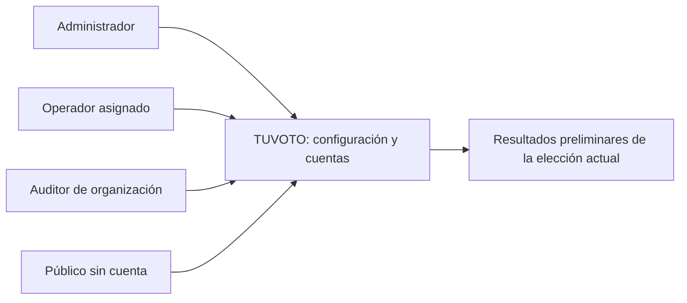
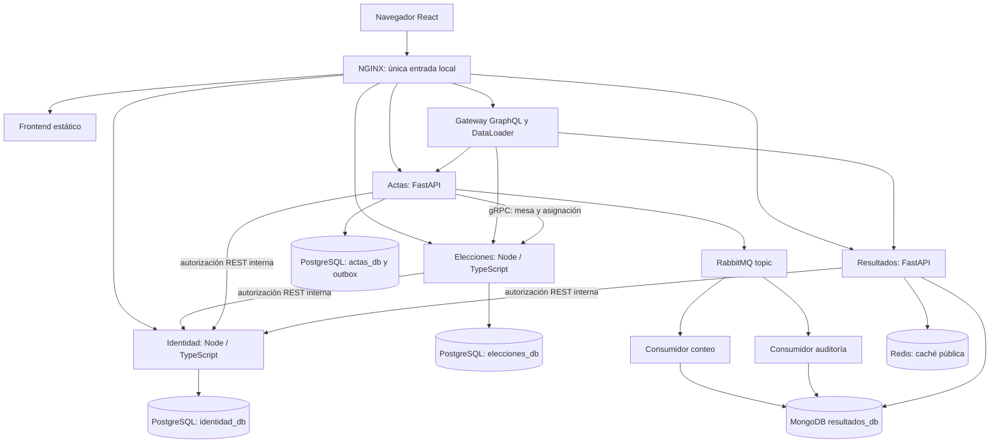

# TUVOTO — Arquitectura P1

Documento de diseño del nuevo producto; no acredita un despliegue completo. Destino acordado: demostración local. Los resultados son preliminares y académicos, no certificación electoral. La fotografía respalda una transcripción manual; OCR pendiente.

## 1. Contexto C4

Administrador configura organizaciones, candidatos, mesas y asignaciones. Operador registra fotografías y cifras de sus mesas; auditor consulta sin publicar. Público ve cifras agregadas y fotografías de candidatos, nunca originales privados de actas. ADMINISTRADOR configura; OPERADOR registra; AUDITOR revisa. Ningún administrador tiene permiso para publicar actas.

## 2. Contenedores C4

Cuatro servicios de negocio, dos lenguajes y trece contenedores Compose. Las bases PostgreSQL son lógicas independientes con usuarios propios sobre una instancia local. Ningún servicio consulta la base de otro.

## 3. Persistencia y consistencia

Identidad: usuarios UUID, hash bcrypt coste 12, roles con organización, sesiones revocables, recuperaciones y auditoría. Elecciones: procesos, candidatos/fotos, unidades representadas por mesas y asignaciones. Actas: versiones inmutables con original y SHA-256, conteo, estado y bandeja transaccional. Resultados: última contribución de cada mesa, eventos auditados e informes; Redis almacena únicamente caché temporal.

Registro y outbox se insertan en una transacción. Bloqueos por mesa, solicitud y fotografía evitan versiones concurrentes y reutilización exacta de imagen en otra mesa. Una corrección reemplaza la contribución anterior; no suma dos veces. Una observación no publica nuevas cifras. Anular genera otra versión y retira la contribución, conservando originales.

SHA-256 detecta igualdad binaria, no prueba autenticidad ni detecta todas las manipulaciones. Persistencia propia no equivale a transacción distribuida: una caída de mensajería retrasa la proyección hasta el reintento del outbox.

## 4. Contratos y comunicación

REST versionado /api/v1, contratos OpenAPI en compartido/contratos/openapi; Swagger de los cuatro servicios a través de NGINX. Identidad administra cuentas, Elecciones procesos, Actas versiones y Resultados informes: no permitir editar totales proyectados para aparentar CRUD.

GraphQL combina elección, conteo y avance de recepción. DataLoader deduplica cargas por operación; caché pública breve agrupa solicitudes concurrentes por filtro de unidad. La mutation registrarActa conserva cookies y CSRF, y la autorización final pertenece a Actas.

gRPC Actas → Elecciones: mesa-v1.proto, deadline 1,2 s, clave interna y autorización por organización/asignación. Códigos UNAUTHENTICATED, PERMISSION_DENIED, INVALID_ARGUMENT, DEADLINE_EXCEEDED y UNAVAILABLE se traducen a HTTP. No se expone el puerto gRPC al host.

RabbitMQ: acta.actualizada.v1, topic, dos colas independientes para conteo/auditoría, ACK manual, mensajes persistentes, idempotencia y DLQ con reintentos acotados. El evento no contiene operador, cookie ni fotografía original.

## 5. ADR-001 — Actas en lugar de voto individual

Estado: aceptada para el alcance TUVOTO solicitado. Contexto: se necesita seguir conteos fotografiados, no emitir votos. Decisión: retirar padrón y emisión individual del árbol activo, integrar candidatos en Elecciones e incorporar Actas. Consecuencias: cuatro servicios pertinentes, menos reglas ajenas; no reutilizar evidencias ni datos SIGAPE como prueba del nuevo producto. El material retirado queda respaldado fuera de Git y Docker.

## 6. ADR-002 — Versiones y bandeja transaccional

Estado: aceptada. Contexto: correcciones y fallos parciales pueden duplicar resultados o perder eventos. Decisión: versiones inmutables y outbox en PostgreSQL; confirmación de publicación y entrega al menos una vez; proyección idempotente por versión de mesa. Consecuencias: recuperación tras caída de RabbitMQ y originales conservados; consistencia eventual y operación del publicador necesarias. No prometer entrega exactamente una vez.

## 7. ADR-003 — Portal público separado de administración

Estado: aceptada. Contexto: muchas consultas públicas y pocas escrituras autorizadas. Decisión: React/NGINX/GraphQL como entrada, consultas agregadas con caché breve; cookies HttpOnly revocables y CSRF para operaciones privadas; verificación de rol, organización y mesa en backend. Consecuencias: público sin cuenta, operador restringido y auditor de lectura; JWT exigido por P3 sigue pendiente, al igual que TLS productivo y medidas de capacidad verificadas.

## 8. Despliegue, pruebas y pendientes

Solo demostración local. Compose tuvoto utiliza nuevas variables TUVOTO_*, volúmenes y red propios, sin migrar ni borrar recursos SIGAPE. Configurar secretos nuevos en archivo privado ignorado, COOKIE_SEGURA=false solo para HTTP local y puerto libre. No publicar repositorio, imágenes ni tags como efecto de leer la rúbrica.

Pruebas disponibles: compilación React/TypeScript; contratos GraphQL y caché; permisos de identidad; reglas y persistencia SQL de Actas en PostgreSQL efímero; proyección y dos consumidores con MongoDB/RabbitMQ efímeros. La matriz requisitos.md distingue código, prueba limitada y demostración pendiente.

Prueba SQL aislada aprobada con 10.000 versiones sintéticas, filtro, paginación y separación de organización. Pendientes P1: CRUD REST integral y Swagger en ejecución, recorrido completo limpio y gRPC entre contenedores, revisión visual móvil/tablet/escritorio. P2: cobertura, comando de pruebas, CI real, Helm/Kubernetes y Argo CD. P3: JWT, TLS, escaneos/SBOM, observabilidad, SLO, resiliencia y JMeter 5.000 usuarios antes/después. No se declara listo para producción.
